# VR Home Construction

**Проектируй. Визуализируй. Живи.**

[](https://github.com/execada/VRHomeConstruction/actions/workflows/ci-cd.yml)


VR Home Construction — наш веб-конструктор интерьера. В браузере можно собрать комнату с нуля
или из шаблона, расставить мебель, подобрать отделку и свет, а потом надеть шлем
(Meta Quest 3/3+ или PC VR) и пройтись по комнате в виртуальной реальности. Ничего не нужно
устанавливать: всё работает в браузере, проекты сохраняются на сервере автоматически.

Проект мы делаем вдвоём: бэкенд на Go с MongoDB, безопасность, инфраструктуру и деплой
веду я ([execada](https://github.com/execada)), а фронтенд на React + three.js — интерфейс,
3D-редактор и VR — [dineredKo](https://github.com/dineredKo). Ниже рассказываю, как устроен
проект, как связаны его части и как его запустить.

## Содержание

- [Что умеет](#что-умеет)
- [Как всё устроено](#как-всё-устроено)
  - [Общая схема](#общая-схема)
  - [Фронтенд](#фронтенд)
  - [Редактор](#редактор)
  - [Жизненный цикл проекта](#жизненный-цикл-проекта)
  - [Бэкенд](#бэкенд)
  - [Регистрация и вход](#регистрация-и-вход)
  - [Данные](#данные)
  - [Продакшен](#продакшен)
- [Структура проекта](#структура-проекта)
- [Запуск](#запуск)
- [Продакшен-деплой](#продакшен-деплой)
- [Деплой на сервер с Caddy](#деплой-на-сервер-с-caddy)
- [CI/CD](#cicd)
- [Переменные окружения](#переменные-окружения)
- [Безопасность](#безопасность)
- [Тесты и качество](#тесты-и-качество)
- [Управление](#управление)
- [Авторы](#авторы)

## Что умеет

**Главная («Мои проекты»).** Вкладки «Все / Избранное / Папки», поиск по названию, описанию
и тегам, плитка или список, превью проектов (снимок сцены), избранное, теги, дублирование,
папки (один проект может лежать в нескольких), импорт и экспорт проекта файлом, светлая
и тёмная темы. На телефоне навигация переезжает вниз экрана.

**Старт проекта.** Пустая комната или один из шести шаблонов: гостиная, спальня,
кухня-столовая, кабинет, студия с перегородкой и двухуровневый пентхаус 255 м² — внизу
гостиная-кухня-столовая с лестницей, гостевой санузел и балкон во всю ширину, наверху холл,
мастер-спальня, спальня, кабинет, ванная и выход на террасу над балконом, а за окнами город
на закате. Любой проект можно сохранить как свой шаблон.

**Редактор 3D и 2D.**
- Мебель встаёт на пол, прижимается к стенам и разворачивается к комнате; не проваливается
  в пол и стены и не пересекается с другой мебелью. Есть сетка 10 см, поворот кольцом,
  дублирование, блокировка и тонирование.
- Подушки садятся на диваны и кресла: у каждой модели свои посадочные места — у спинки
  (подушка опирается на неё с наклоном) и на сиденье (лёжа). Подушка, брошенная на диван,
  встаёт в ближайшее свободное место; места подсвечиваются при перетаскивании, подушку можно
  довернуть на ±35°, диван переносит подушки с собой. Ручной чек-лист — `docs/manual-checklist.md`.
- Стены: у каждой своя толщина и конструкционный материал (кирпич, силикатный кирпич,
  газобетон, пеноблок, бетон, монолитный ж/б, гипсокартон, брус) — отдельно от отделки;
  материал виден в разрезе стены, на плане (штриховка) и на всей стене «без отделки».
- Внутренние стены рисуются по полу (в 3D и на плане) с привязкой к стенам, углам 45°
  и сетке; стыки Г, Т и Х строятся без наложений. Помещения вычисляются по стенам:
  площадь по граням стен, периметр, название, вид (комната, лоджия, балкон).
- Проёмы — окна (в том числе панорамные, от пола до потолка) и дверные проёмы с дверью:
  модель полотна, петли слева/справа, сторона открывания, плавное открывание кликом
  в 3D, в VR и из инспектора.
- Этажи: до пяти этажей друг над другом. У каждого свои размеры и смещение (по умолчанию —
  контур этажа ниже), внешние и внутренние стены, проёмы и двери, помещения, свет и мебель.
  Между этажами — перекрытие: снизу потолок, сверху пол верхнего этажа, торцы видны по фасаду.
  Переключатель этажей на сцене и плане: добавить этаж сверху, переименовать, удалить
  (с подтверждением, Ctrl+Z возвращает), выбрать этаж для редактирования. Крыша нижнего
  этажа, не закрытая верхним, становится террасой со стеклянным ограждением.
- Лестницы: прямой марш или марш с площадкой — инструментом «Лестница» или из каталога.
  Ступени считаются от высоты подъёма (высота этажа + перекрытие): подступёнок до 20 см,
  проступь по формуле шага 2h + b ≈ 63 см. Вырез в перекрытии над лестницей появляется сам,
  вокруг него наверху — стеклянное ограждение; мебель не встаёт на марш и в проём.
- 2D-план и развёртки стен с тем же редактированием, синхронно с 3D; этаж ниже видно
  полупрозрачной подложкой, проём лестницы — пунктиром.
- PBR-текстуры стен, пола и потолка, светильники, солнце за окнами (время суток и сторона
  света), фотопанорама за окном.
- Вид наружу без растянутых текстур: панорама 4K — только фон (небо и дальний горизонт),
  а всё близкое — настоящая 3D-сцена. За городом — газон, перекрашенный в цвет травы
  со снимка и вдали плавно переходящий в саму фотографию (шва у горизонта нет).
  В городе квартира стоит на верхнем этаже высотки: терраса со стеклянным ограждением,
  стеклянный фасад башни с отражением города и кварталы внизу, вечером с огнями в окнах.
- Камера: облёт активного этажа (этажи выше скрыты), от первого лица (ходьба, бег, прыжок,
  подъём и спуск по лестнице — высота глаз следует ступеням, этаж под ногами становится
  активным), план сверху, фиксированные виды и «Улица» — облёт здания снаружи целиком,
  без срезов, с перекрытиями, террасами и крышей; с улицы от первого лица начинают перед
  фасадом и обходят здание по участку.
- Пресеты графики, отмена и повтор, автосохранение и работа без сети.

**VR (WebXR).** Quest Browser на Meta Quest 3/3+ и PC VR (Chrome/Edge + Quest Link,
Air Link или SteamVR через OpenXR): телепорт на пол любого этажа и участок, плавное движение
(в том числе вверх и вниз по лестнице), захват мебели лучом, поворот стиком, вибрация,
меню на запястье, отслеживание рук, фовеация.

## Как всё устроено

### Общая схема

Браузер скачивает приложение и ассеты у nginx, а данные получает у Go API через `/api`.
В продакшене всё стоит в Docker Compose; наружу открыт только nginx.

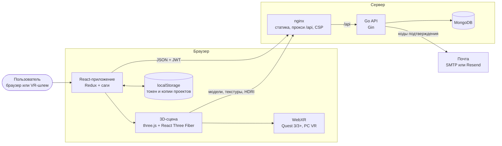

### Фронтенд

Фронтенд разложен по Feature-Sliced Design: каждый слой может использовать только слои
ниже себя. Так фичи не зависят друг от друга по кругу, а страницы собираются из готовых блоков.

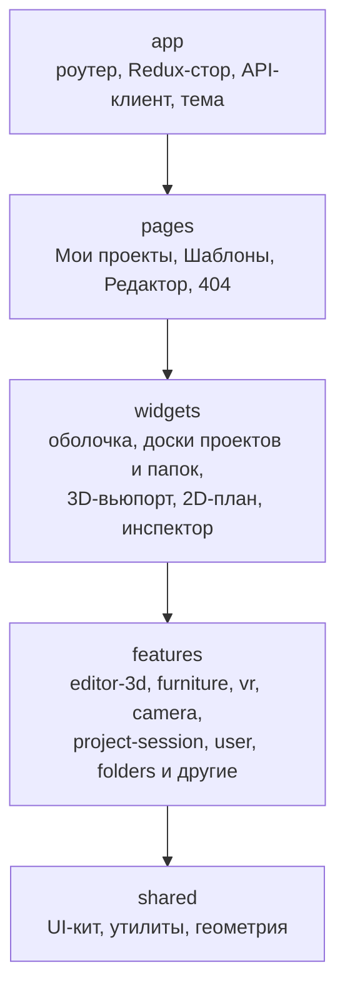

Состояние живёт в Redux Toolkit, а всё, что ходит в сеть или в localStorage, делают саги
(typed-redux-saga). Ответы сервера проверяются Zod-схемами ещё до того, как попадут в стор,
а ошибки переводятся в понятный русский текст.

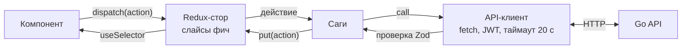

Редактор подгружается отдельным чанком: на главной не грузится three.js, поэтому она
открывается быстро.

### Редактор

Главная идея редактора — одно состояние и одни команды на все режимы. 3D-сцена, 2D-план,
VR и инспектор свойств меняют комнату через одни и те же команды сцены, а те проверяют
ограничения: предметы не пересекаются, проёмы не накладываются, всё остаётся внутри комнаты.
Поэтому режимы всегда синхронны.

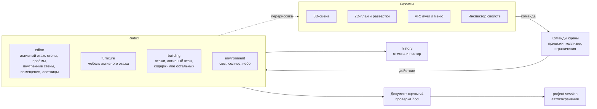

Редактируется активный этаж: его содержимое «живёт» в слайсах `editor` и `furniture`, поэтому
все команды, 2D-план и инспектор работают с ним как с обычной комнатой. Остальные этажи лежат
в слайсе `building`. Смена, добавление и удаление этажа — одно действие, которое обрабатывают
все три слайса: документ сцены ни в какой момент не бывает «наполовину переключён», а смена
этажа не попадает в историю и не запускает сохранение. В 3D каждый этаж стоит на своей высоте
(пол первого этажа — y = 0); события указателя переводятся в координаты активного этажа.

То, что меняется каждый кадр (перетаскивание, «призрак» новой модели, поворот), хранится
вне Redux, в лёгком сторе взаимодействия, — иначе каждое движение мыши перерисовывало бы
всё приложение. Перетаскивание склеивается в один шаг истории: Ctrl+Z отменяет его целиком.

### Жизненный цикл проекта

Проект сохраняется сам. Каждая правка сначала через 0,4 с пишется локальной копией
в localStorage, а через 1,5 с тишины уходит на сервер. Если сеть пропала, работа
продолжается, а при следующем открытии более свежая локальная копия восстанавливается
и досохраняется.

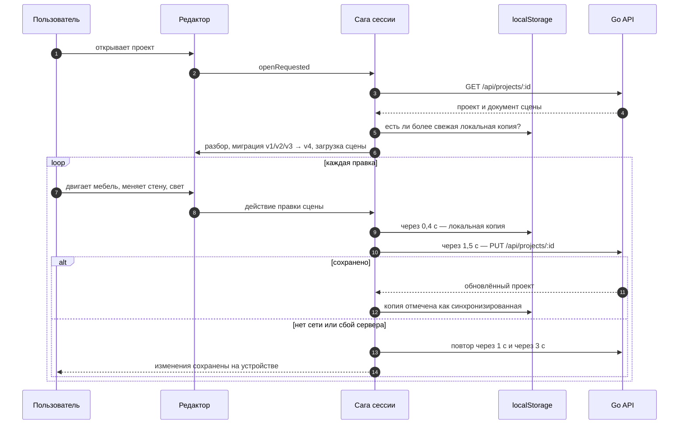

Вместе со сценой сохраняются поза камеры и превью проекта (снимок сцены не чаще раза
в минуту) — его видно на карточке на главной.

### Бэкенд

Бэкенд — Go + Gin, слои `handlers → services → repositories`. Интерфейсы хранилищ объявлены
в сервисах, поэтому бизнес-логика тестируется на фейках, а репозитории — на настоящей MongoDB.

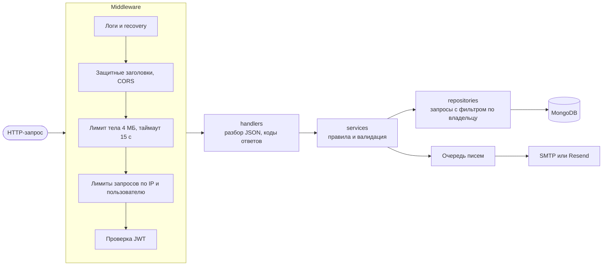

Каждая запись в базу идёт с фильтром `{_id, userId}`: чужой проект нельзя ни прочитать,
ни изменить, ни удалить, а на попытку сервер отвечает 404, не раскрывая, что проект существует.

### Регистрация и вход

Вход — по почте и паролю. Регистрация подтверждается кодом из письма, а чтобы кто-то другой
не мог перехватить незавершённую регистрацию, код принимается только вместе с токеном заявки,
который получил тот, кто её начал.

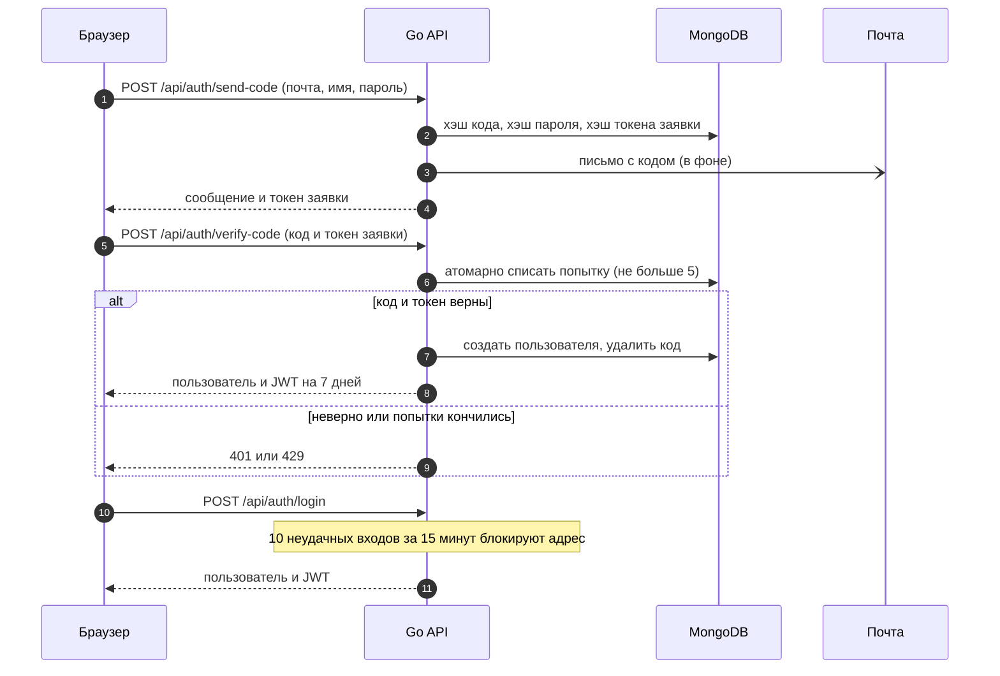

### Данные

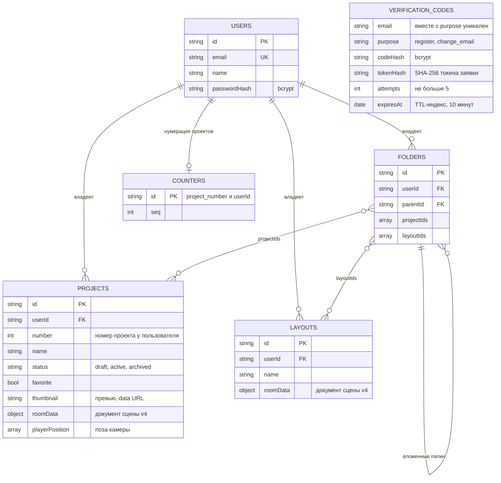

Само здание хранится в `roomData` как документ сцены. Формат принадлежит фронтенду,
у него есть версия и Zod-схема; старые проекты форматов v1, v2 и v3 мигрируют при открытии,
а повреждённые элементы (и этажи) отбрасываются, не ломая весь проект.

Формат v4 (миграция v3 → v4 — `editor-3d/lib/scene/migrateV3.ts`):
- `floors` — этажи снизу вверх, от одного до пяти: `{ id, name, offset: [x, z], dimensions,
  outerWalls, finishes, removedWalls, light, openings, partitions, rooms, stairs, furniture }`.
  Содержимое этажа — то же, что у квартиры v3, координаты — свои у каждого этажа (центр этажа —
  начало координат), `offset` — смещение центра этажа в здании. Пол этажа i+1 выше пола этажа i
  на высоту этажа i и толщину перекрытия; проект v3 становится этажом `floor-1` «1 этаж»
  без потерь, с пустым списком лестниц;
- `slabThickness` — толщина перекрытия между этажами и крыши, 0,15–0,6 м (по умолчанию 0,3);
- `stairs` — лестницы этажа на этаж выше (или на крышу): `{ id, kind: straight | landing,
  position: [x, z], rotation, width }`; поворот кратен 90° (подъём при 0 — к задней стене),
  ширина 0,7–2 м. Ступени, длина марша и вырез в перекрытии не хранятся — они считаются
  по высоте подъёма (`editor-3d/lib/stairs`);
- `environment` — солнце и небо, общие для здания.

Формат v3 (миграция v2 → v3 — `editor-3d/lib/scene/migrateV2.ts`):
- `outerWalls` — толщина и материал каждой внешней стены вместо общего `wallThickness`
  (старая толщина копируется на все стены, материал — кирпич); стена растёт наружу;
- `partitions[].material` — материал внутренней стены (старые: до 15 см — гипсокартон,
  толще — газобетон); стыки и помещения не хранятся — они вычисляются по стенам;
- `openings[].door` — дверь в дверном проёме: `style`, `hinge` (`start`/`end` — у начала
  или конца проёма вдоль стены), `swing` (`front` — в сторону нормали стены, у внешних стен
  в комнату), `open`, `color`; без `door` — пустой проём (старые двери получают гладкое
  закрытое полотно, как они и рисовались);
- `rooms` — подписи помещений `{ id, name, anchor: [x, z], kind: room | loggia | balcony }`:
  подпись находит своё помещение по точке; лоджия и балкон входят в общую площадь
  с коэффициентами 0,5 и 0,3;
- окна: отступ от пола от 0 и высота до потолка (панорамное остекление), ширина — до длины стены.

Новый материал стены — одна запись в `editor-3d/lib/wallMaterials.ts` (название, типовые
толщины, процедурная текстура, штриховка плана); новая модель двери — запись в `lib/doors.ts`.

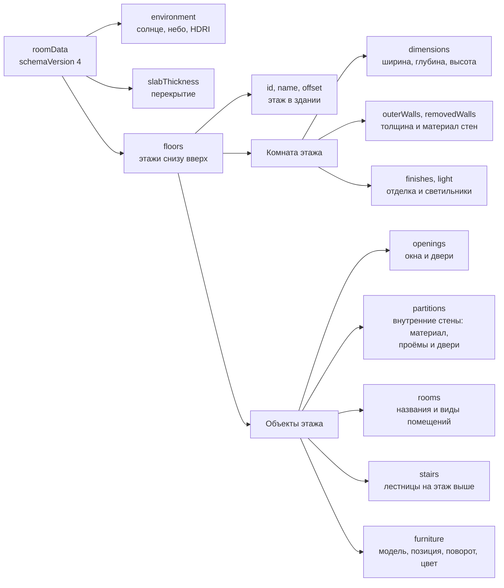

### Продакшен

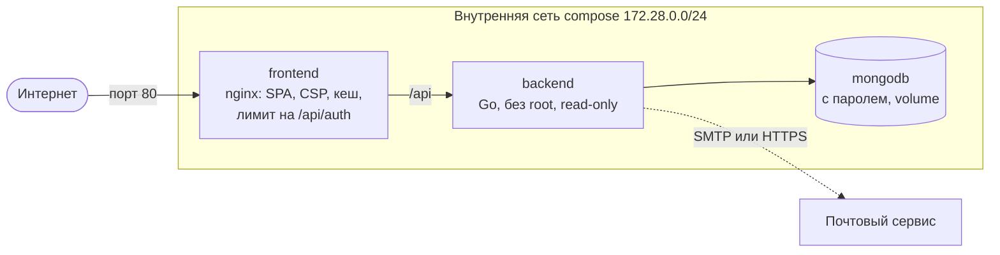

## Структура проекта

```text
.
├── src/                          фронтенд (React 19, TypeScript strict)
│   ├── app/                      точка сборки приложения
│   │   ├── api/                  HTTP-клиент, Zod-схемы ответов, тексты ошибок
│   │   ├── router/               маршруты; редактор грузится лениво
│   │   ├── store/                Redux-стор и корневая сага
│   │   ├── providers/            тема и общие провайдеры
│   │   └── styles/               дизайн-токены (светлая и тёмная темы)
│   ├── pages/                    страницы
│   │   ├── my-projects/          «Мои проекты»: проекты, избранное, папки
│   │   ├── templates/            встроенные и свои шаблоны
│   │   ├── project-editor/       редактор: панель, сцена, инспектор
│   │   └── not-found/            404
│   ├── widgets/                  крупные блоки интерфейса
│   │   ├── app-shell/            боковая панель, шапка, уведомления
│   │   ├── project-board/        сетка и список проектов, диалоги
│   │   ├── folder-board/         папки
│   │   ├── template-picker/      выбор стартового шаблона
│   │   ├── scene-viewport/       3D-вьюпорт и оверлеи
│   │   ├── plan-editor-2d/       2D-план и развёртки стен (SVG)
│   │   ├── editor-topbar/        шапка редактора: режимы, камера, VR, сохранение
│   │   ├── editor-panel/         каталог мебели, отделка, комната, свет, вид
│   │   ├── editor-inspector/     свойства выделенного объекта
│   │   └── settings-drawer/      профиль и тема
│   ├── features/                 бизнес-фичи
│   │   ├── editor-3d/            здание и этажи, комната, стены и материалы, стыки, помещения,
│   │   │                         проёмы и двери, лестницы, перекрытия, хождение по этажам,
│   │   │                         команды сцены, документ сцены v4 (схема, миграции)
│   │   ├── furniture/            каталог и расстановка мебели, процедурные модели
│   │   ├── vr/                   WebXR: перемещение, захват мебели, меню на запястье
│   │   ├── camera/               облёт, от первого лица, план сверху, фиксированные виды, улица
│   │   ├── textures/             PBR-отделка и процедурные материалы
│   │   ├── environment/          свет, солнце, небо и HDRI
│   │   ├── graphics/             пресеты качества рендера
│   │   ├── history/              отмена и повтор
│   │   ├── selection/            выделение объектов
│   │   ├── project-session/      открытие, автосохранение, локальная копия, превью
│   │   ├── assets/               манифест ассетов (HDRI, текстуры, модели)
│   │   ├── templates/            встроенные шаблоны комнат
│   │   ├── user/                 вход, регистрация, профиль, смена почты
│   │   ├── create-project/       список проектов
│   │   ├── project-actions/      избранное, дублирование, удаление
│   │   ├── folders/              папки (оптимистично, с откатом при ошибке)
│   │   └── …                     поиск, уведомления, тема, модальные окна
│   └── shared/                   UI-кит, утилиты, математика, хранилище
├── backend/                      Go API
│   ├── cmd/server/               запуск, сборка зависимостей, graceful shutdown
│   └── internal/
│       ├── config/               переменные окружения и проверка конфигурации
│       ├── server/               роутер и цепочка middleware
│       ├── middleware/           JWT, CORS, заголовки, лимиты, таймауты
│       ├── handlers/             HTTP-слой
│       ├── services/             бизнес-логика и валидация
│       ├── repositories/         MongoDB (с интеграционными тестами)
│       ├── database/             подключение и индексы
│       ├── email/                SMTP, Resend, маскирование адресов в логах
│       ├── auth/                 выпуск и проверка JWT
│       └── models/               структуры запросов и документов
├── public/
│   ├── assets/                   ассеты: HDRI, PBR-текстуры, 61 модель мебели (CC0, одна CC BY),
│   │                             manifest.json и LICENSES.md
│   └── models/                   дополнительные модели мебели
├── e2e/                          сценарии Playwright
├── deploy/                       nginx.conf, заголовки безопасности (CSP), шаблон prod.env
├── scripts/                      список моделей и конвейер библиотеки моделей (scripts/models)
├── docker-compose.prod.yml       продакшен-стек
├── Dockerfile                    образ фронтенда: сборка → nginx
└── run.sh / stop.sh              запуск всего проекта одной командой / остановка
```

Подробное описание API бэкенда — в [backend/README.md](backend/README.md), E2E — в
[e2e/README.md](e2e/README.md), история изменений — в [REPORT.md](REPORT.md),
планы — в [TODO.md](TODO.md).

## Запуск

Нужны Docker, Node.js 20.19+ (проверено на 24) и npm. Для публичной ссылки — ngrok 3.x
с настроенным authtoken.

```bash
cp backend/.env.example backend/.env && chmod 600 backend/.env
./run.sh
```

Скрипт поднимает MongoDB и бэкенд в Docker, ставит зависимости фронтенда, запускает
dev-сервер на `http://localhost:3000` и печатает публичную ссылку ngrok (её можно открыть
и в шлеме). Закрыть ссылку паролем: `NGROK_BASIC_AUTH='user:пароль' ./run.sh`.
Остановка — `Ctrl+C`, полностью вместе с Docker — `./stop.sh`.

Без ngrok:

```bash
cd backend && docker compose up -d --build   # MongoDB и API на 127.0.0.1
cd .. && npm install && npm run dev          # http://localhost:3000
```

Пока почта не настроена, код подтверждения регистрации печатается в логах бэкенда:

```bash
docker logs vr-backend 2>&1 | grep '\[CODE\]' | tail -1
```

| Сервис | Адрес |
|---|---|
| Приложение | http://localhost:3000 |
| API | http://localhost:8080/api |
| Mongo Express | `docker compose -f docker-compose.yml -f docker-compose.tools.yml up -d mongo-express` в `backend/` → http://localhost:8081/mongo-express/ |

## Продакшен-деплой

```bash
cp deploy/prod.env.example deploy/prod.env   # пароль MongoDB: openssl rand -hex 24
cp backend/.env.example backend/.env         # JWT_SECRET (openssl rand -hex 48), почта, ALLOWED_ORIGINS
chmod 600 deploy/prod.env backend/.env

docker compose --env-file deploy/prod.env -f docker-compose.prod.yml up -d --build
curl http://localhost/api/health             # {"status":"ok"}
```

Бэкенд в продакшене не стартует без надёжного `JWT_SECRET`, без настоящей почты и с CORS `*`.
Если перед nginx стоит балансировщик или CDN, его адреса нужно добавить в `TRUSTED_PROXIES`,
а при работе по HTTPS — включить HSTS в [deploy/security-headers.conf](deploy/security-headers.conf).

## Деплой на сервер с Caddy

Если на сервере уже работает Caddy (как у меня), nginx не нужен: Caddy раздаёт фронтенд
как статику, выпускает HTTPS-сертификат и проксирует `/api` на бэкенд, а бэкенд и MongoDB
работают в Docker. Всё собирается на машине разработчика — серверу не нужны Node и Go,
и он почти не тратит место на диске.

```bash
SERVER=root@45.12.255.39 DOMAIN=vrhome.45.12.255.39.nip.io ./deploy/server/deploy.sh
```

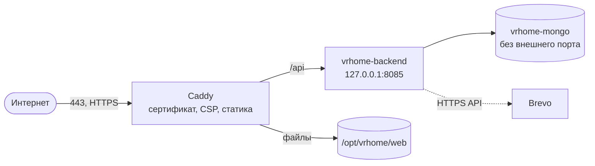

Скрипт собирает фронтенд и бэкенд (linux/amd64), загружает их в `/opt/vrhome`, при первом
запуске создаёт на сервере секреты (пароль MongoDB, `JWT_SECRET`) и подключает сайт в Caddy
отдельным файлом. Повторный запуск обновляет версию без потери данных.
`nip.io` превращает IP в имя (`vrhome.45.12.255.39.nip.io` → `45.12.255.39`), поэтому
HTTPS работает без своего домена; свой домен — это просто другое значение `DOMAIN`.

**Почта.** Многие хостинги закрывают исходящий SMTP. Тогда коды отправляются через HTTPS API
Brevo: в `/opt/vrhome/backend.env` нужны `BREVO_API_KEY` и `BREVO_FROM`, после чего
`ALLOW_LOG_ONLY_MAIL=true` удаляется и бэкенд перезапускается
(`cd /opt/vrhome && docker compose up -d`).

### Администратор

Администратор входит по логину, а не по почте. Создать его (или задать новый пароль) —
одной командой на сервере; пароль вводится скрыто и в истории команд не остаётся:

```bash
ssh -t root@45.12.255.39 docker exec -it vrhome-backend /app/server create-admin --login execada
```

Почту можно указать сразу (`--email`) или позже в настройках профиля.

## CI/CD

Каждый push и pull request проверяет GitHub Actions ([ci-cd.yml](.github/workflows/ci-cd.yml)).
После зелёного CI в `main` новая версия сама выкатывается на сервер.

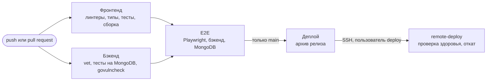

- **E2E в CI** поднимает MongoDB и бэкенд, регистрирует тестовый аккаунт через API (код берётся
  из лога бэкенда) и прогоняет все сценарии Playwright; при падении отчёт сохраняется в артефактах.
- **Деплой** идёт не от root: у пользователя `deploy` нет пароля, shell и доступа к Docker, его ключ
  привязан к одной команде, а через `sudo` он может выполнить только `remote-deploy` без аргументов —
  обновить статику и бэкенд. Compose-файл и сайт Caddy меняются только ручным
  `deploy/server/deploy.sh` с ключом администратора, поэтому доступ к `main` не даёт root на сервере.
- **Откат автоматический**: если новая версия не отвечает на `/api/health`, возвращаются прежние
  статика и бинарник; на сервере хранятся три последних релиза (`/opt/vrhome/releases`).
- Секреты — в окружении GitHub `production`: `DEPLOY_SSH_KEY`, `DEPLOY_KNOWN_HOSTS`, `DEPLOY_HOST`;
  домен — переменная `DEPLOY_DOMAIN`. Пользователь на новом сервере создаётся скриптом
  [deploy/server/setup-ci-user.sh](deploy/server/setup-ci-user.sh).

## Переменные окружения

Шаблон — [backend/.env.example](backend/.env.example). Сам `.env` в репозиторий не попадает.

| Переменная | Назначение |
|---|---|
| `APP_ENV` | `development` / `dev` / `local` — разработка, любое другое значение — продакшен |
| `PORT` | порт API, по умолчанию `8080` |
| `MONGO_URI` | строка подключения к MongoDB |
| `JWT_SECRET` | секрет подписи сессий, не короче 32 байт; в разработке без него создаётся временный |
| `ALLOWED_ORIGINS` | origin-ы для CORS через запятую (в разработке пусто — `*`) |
| `TRUSTED_PROXIES` | прокси, которым можно верить в `X-Forwarded-For` |
| `SMTP_HOST`, `SMTP_PORT`, `SMTP_USER`, `SMTP_PASSWORD`, `SMTP_FROM` | отправка кодов по SMTP |
| `SMTP_LOG_ONLY` | не отправлять письма, печатать код в лог (только разработка) |
| `BREVO_API_KEY`, `BREVO_FROM` | отправка кодов через Brevo (HTTPS, работает при закрытом SMTP) |
| `RESEND_API_KEY`, `RESEND_FROM` | отправка кодов через Resend |
| `ALLOW_LOG_ONLY_MAIL` | `true` — запустить production без почты, коды в лог (временно) |
| `MONGO_EXPRESS_USER`, `MONGO_EXPRESS_PASSWORD` | вход в mongo-express (только локально) |

## Безопасность

- Пароли и коды — bcrypt; токен заявки на регистрацию хранится как SHA-256; JWT — только
  HS256 с обязательным сроком действия.
- Попытки ввода кода списываются атомарно (не больше 5 даже при параллельных запросах),
  повторная отправка — не чаще раза в 30 секунд, вход блокируется после 10 неудач за 15 минут.
- Смена почты требует текущий пароль.
- Все записи в базу — с фильтром по владельцу; квоты и валидация входных данных на сервере
  (размеры сцены, пути моделей, превью, поза камеры, вложенность папок без циклов).
- Лимиты запросов по IP и по пользователю; `X-Forwarded-For` принимается только от
  доверенного прокси.
- В логах нет кодов и полных адресов почты, клиент не видит внутренних ошибок.
- nginx отдаёт строгую CSP (всё только со своего origin), `Permissions-Policy` с разрешением
  WebXR; бэкенд в контейнере работает без root на read-only файловой системе.
- Зависимости проверяются `govulncheck` и `npm audit`.

## Тесты и качество

| Проверка | Результат |
|---|---|
| `npm run lint` — ESLint, Stylelint, Knip | 0 ошибок и предупреждений |
| `npm run typecheck` | 0 ошибок |
| `npm run test:coverage` — Vitest | 866 тестов, ≈ 98,8 % строк |
| `npm run test:e2e` — Playwright | 11 сценариев: гость, вход, главная, папки, шаблоны, редактор, автосохранение, этажи и лестница, подъём от первого лица, вид с улицы, старый одноэтажный проект |
| `go test -race ./...` | все пакеты, ≈ 93 % покрытия, репозитории — на настоящей MongoDB |
| `govulncheck ./...` | 0 уязвимостей в вызываемом коде |

Перед первым запуском E2E: `npx playwright install chromium` и тестовый аккаунт
в `e2e/.env.e2e.local` (см. [e2e/README.md](e2e/README.md)).

| Команда | Что делает |
|---|---|
| `npm run dev` | dev-сервер на `:3000`, `/api` проксируется на `:8080` |
| `npm run build` | проверка типов и прод-сборка в `dist/` |
| `npm run lint` / `npm run typecheck` | линтеры / TypeScript (приложение и E2E) |
| `npm test` / `npm run test:coverage` | тесты Vitest / с покрытием |
| `npm run test:e2e` | E2E-сценарии |
| `npm run generate-models` | пересобрать список моделей из `public/models` |
| `npm run models:sync` / `models:check` | скачать модели Poly Haven, измерить, обновить манифест и LICENSES.md / проверить, что они актуальны |
| `npm run models:procedural` / `models:thumbs` | собрать процедурные модели / отрисовать превью |
| `cd backend && go vet ./... && go test -race ./...` | проверки бэкенда |

## Управление

| Действие | Клавиши и мышь |
|---|---|
| Выбрать / переместить предмет | клик / перетаскивание |
| Повернуть выделенное | **R** или кольцо вокруг предмета (Shift — без шага) |
| Удалить / копия / блокировка | **Del** / **Ctrl+D** / **L** |
| Сетка | **G** |
| Отменить / повторить | **Ctrl+Z** / **Ctrl+Shift+Z** |
| Сохранить сейчас | **Ctrl+S** |
| От первого лица | **ЛКМ** + мышь — осмотр, **W A S D** — ходьба (по лестнице — на другой этаж), **Shift** — бег, **Space** — прыжок, **C** — присесть |
| Камера | **1** облёт · **2** от первого лица · **3** план · **4** улица |
| Этажи | переключатель слева вверху на сцене и плане: **+** — этаж сверху, клик — редактировать этаж, двойной клик или ✎ — переименовать, корзина — удалить |
| Лестница | инструмент «Лестница» (или карточка в каталоге), клик по полу — поставить, **R** — поворот на 90°, **Shift**+клик — ещё одна, **Esc** — закончить |

**В шлеме:** откройте приложение по HTTPS-адресу, доступному со шлема (например, ссылка
из `./run.sh`), войдите, откройте проект и нажмите **VR**. Телепорт — стик вперёд и луч
на пол любого этажа, по лестнице — плавным движением, мебель — захват курком и поворот
стиком, меню — кнопка **Y**.

## Ассеты

HDRI, фото для фона (их 4K-версии) и PBR-текстуры в `public/assets` — CC0 с Poly Haven. Модели мебели (61) — фотореалистичные
PBR-модели в метрах с текстурами 1K: 39 с Poly Haven (CC0), диван и кресло из Khronos glTF Sample
Assets (CC BY 4.0 и CC0), унитаз и раковины с OpenGameArt (CC0) и 17 процедурных моделей проекта
(кухонные модули, холодильник, ванна, душ, тумба с раковиной, стиральная машина, кровать, ковры,
торшер, зеркало, телевизор) с CC0-текстурами Poly Haven. Авторы, ссылки и атрибуции —
в [public/assets/LICENSES.md](public/assets/LICENSES.md).

**Конвейер.** Модели описаны в `scripts/models/models.config.json`; `npm run models:sync`
идемпотентно (по md5) скачивает glTF 1K с Poly Haven, измеряет габариты, проверяет их по категории
и переписывает раздел `models` манифеста и таблицы в LICENSES.md. Новая модель Poly Haven —
одна строка в конфиге; своя модель — папка в `public/assets/models/<id>/` и запись `local`
с автором и лицензией, затем `npm run models:thumbs` и `npm run models:sync`.

**Нормализация размеров.** У каждой модели в манифесте есть категория, реальные габариты
(`dimensions`, м) и при необходимости поправки `normalize`: единицы (`unit`: m/cm/mm/dm/in),
ось «вверх» (`upAxis`), поворот фасадом к +Z (`rotationY`) и один целевой размер
(`targetHeight`/`targetWidth`/`targetDepth`). При загрузке модель нормализуется автоматически:
если габариты неправдоподобны для категории, подбираются единицы и ось, затем применяются
поправки, низ ставится на пол, центр — в начало координат; размеры вне диапазона категории
видны в консоли дев-сборки и не проходят конвейер. Так нашлась `steel_frame_shelves_01`,
которая в исходном файле в 10 раз больше реальной.

**Совместимость.** Процедурные `primitive:*` из каталога убраны — их заменили модели, — но сцена
по-прежнему рендерит их в старых проектах без миграции: позиции, повороты и размеры сохранённых
предметов не меняются, инспектор показывает их названия. Пути `/models/*.glb` работают как прежде.
Встроенные шаблоны собраны из новых моделей.

## Авторы

| Автор | Зона ответственности |
|---|---|
| [execada](https://github.com/execada) | бэкенд (Go, MongoDB), безопасность, инфраструктура, CI/CD и деплой |
| [dineredKo](https://github.com/dineredKo) | фронтенд: интерфейс, 3D-редактор (three.js), VR (WebXR) |
